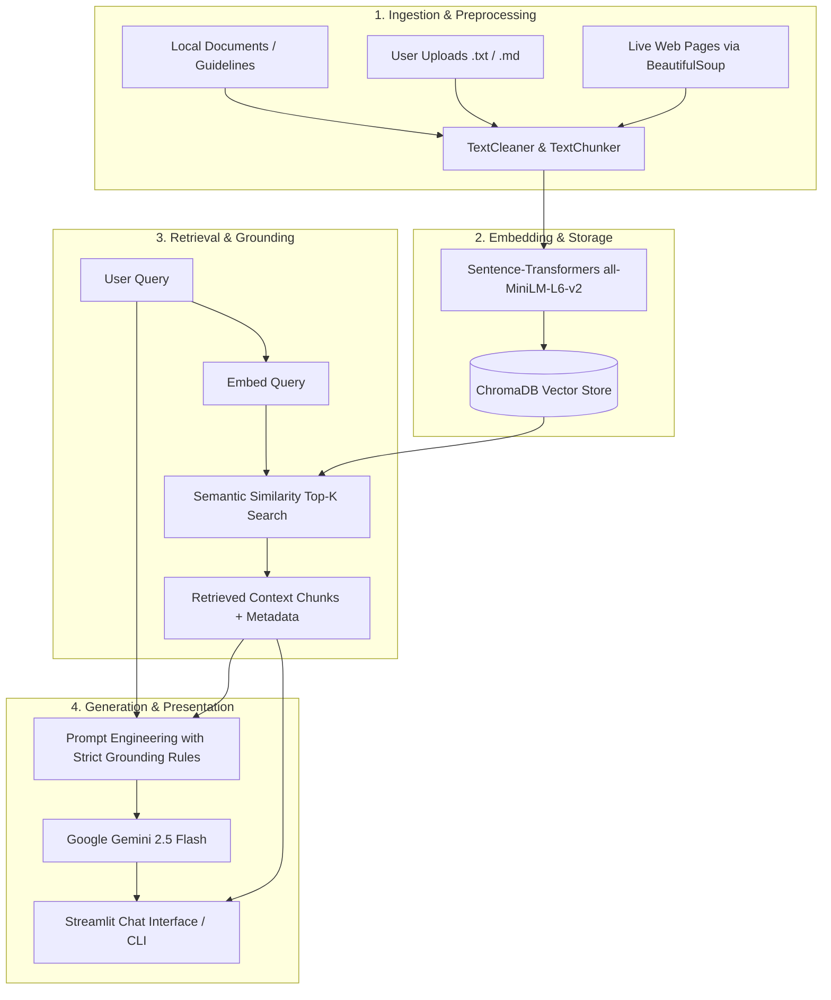

# 🤖 RAG Agent — Intelligent Retrieval-Augmented Generation Assistant

[](https://www.python.org/)
[](https://streamlit.io/)
[](https://www.trychroma.com/)
[](https://ai.google.dev/)
[](LICENSE)

An end-to-end, production-ready **Retrieval-Augmented Generation (RAG)** assistant built with **Python**, **Google Gemini**, **ChromaDB**, and **Streamlit**. Designed to demonstrate production-grade semantic search, vector databases, and context-grounded LLM generation.

This application eliminates model hallucinations by strictly grounding answers in custom knowledge sources—including local documents, uploaded files, and live web-scraped data—while citing exact sources and similarity scores for every response.

---

## 📌 Table of Contents

- [Overview](#-overview)
- [System Architecture](#-system-architecture)
- [Key Features](#-key-features)
- [Project Structure](#-project-structure)
- [Prerequisites](#-prerequisites)
- [Installation & Setup](#-installation--setup)
- [Running the Application](#-running-the-application)
  - [1. Streamlit Web UI](#1-streamlit-web-ui)
  - [2. CLI & Interactive Mode](#2-cli--interactive-mode)
  - [3. Programmatic Usage](#3-programmatic-usage)
- [Component Breakdown](#-component-breakdown)
- [Configuration & Environment Variables](#-configuration--environment-variables)
- [Troubleshooting & FAQs](#-troubleshooting--faqs)
- [License & Acknowledgments](#-license--acknowledgments)

---

## 💡 Overview

Traditional Large Language Models (LLMs) rely solely on static training data, leading to hallucinations or outdated information. **RAG (Retrieval-Augmented Generation)** acts like an "open-book exam":
1. **Retrieve:** Finds relevant chunks from a high-dimensional vector database based on user intent.
2. **Augment:** Injects retrieved context along with provenance metadata into an engineered prompt.
3. **Generate:** Uses Google Gemini with factual personas to formulate accurate answers with clear source attribution.

---

## 🏗️ System Architecture



---

## ✨ Key Features

- **Multi-Source Ingestion:** Ingest documents dynamically from local text files, markdown uploads, or live web pages via BeautifulSoup.
- **Intelligent Chunking:** Sliding-window word-based and sentence-aware chunking preserving contextual overlap.
- **Semantic Vector Search:** Powered by ChromaDB using `sentence-transformers/all-MiniLM-L6-v2` embeddings for sub-second semantic retrieval.
- **Hallucination Protection:** Low-temperature configuration (`temperature=0.3`) combined with strict system personas preventing made-up answers.
- **Source Attribution & Provenance:** Every response provides citations and expandable views of retrieved document snippets with cosine similarity scores.
- **Interactive Streamlit Web Interface:** Modern, clean chat UI with document uploader, live chapter URL scraper, vector store statistics, and session controls.
- **Modular Design:** Self-contained modules for text cleaning, cosine similarity calculation, FAQ matching, chunking, and Gemini API interaction.

---

## 📂 Project Structure

```text
RAG-AGENT/
│
├── streamlit_app.py        # Streamlit web application with chat UI, file upload & scraping
├── rag_agent.py            # Core RAG Agent class orchestrating retrieval & generation
├── knowledge_base.py       # ChromaDB vector store wrapper & similarity search
├── chunking_utility.py     # Sliding-window word and sentence chunking utilities
├── gemini_wrapper.py       # Wrapper for Google GenAI SDK (Gemini 2.5 Flash)
├── semantic_similarity.py  # Cosine similarity & vector distance mathematics
├── faq_finder.py           # Intelligent FAQ matching using intent & semantic similarity
├── text_cleaner.py         # Regex text normalization, sanitization & preprocessing
├── requirements.txt        # Project dependencies
├── .env.example            # Sample environment variables template
└── README.md               # Project documentation
```

---

## ⚙️ Prerequisites

- **Python:** Version `3.10` or higher
- **Gemini API Key:** A free API key from [Google AI Studio](https://aistudio.google.com/app/apikey)
- Operating System: macOS, Linux, or Windows

---

## 🚀 Installation & Setup

### 1. Clone the Repository
```bash
git clone <repository-url>
cd RAG-AGENT
```

### 2. Create and Activate a Virtual Environment
```bash
# macOS/Linux
python3 -m venv venv
source venv/bin/activate

# Windows (Command Prompt / PowerShell)
python -m venv venv
venv\Scripts\activate
```

### 3. Install Dependencies
```bash
pip install --upgrade pip
pip install -r requirements.txt
```

### 4. Configure Environment Variables
Copy the sample environment file to create `.env`:
```bash
cp .env.example .env
```
Open `.env` and add your Google Gemini API key:
```env
GEMINI_API_KEY=your_gemini_api_key_here
```

*(Note: You can also enter the API key directly in the Streamlit sidebar if you prefer not to use a `.env` file).*

---

## 🖥️ Running the Application

### 1. Streamlit Web UI
Launch the interactive web application:
```bash
streamlit run streamlit_app.py
```
Open your browser at `http://localhost:8501`.

**What you can do in the Web UI:**
- **Chat:** Ask questions about loaded knowledge in real time.
- **Upload:** Add `.txt` or `.md` files to immediately index them into ChromaDB.
- **Web Scraping:** Input any web page or documentation URL to scrape and vectorize live content.
- **Inspect Sources:** Expand the "View Sources" dropdown under any answer to see similarity percentages and text excerpts.
- **Monitor Stats:** Track total chunks indexed and embedding dimensions in the sidebar.

### 2. CLI & Interactive Mode
You can run the RAG agent directly from the command line:
```bash
python rag_agent.py
```
This triggers an interactive terminal session where you can query the knowledge base and inspect retrieval steps in verbose mode.

### 3. Programmatic Usage
Use the modular components in your own Python scripts:

```python
import os
from knowledge_base import KnowledgeBase
from rag_agent import RAGAgent

# 1. Initialize Knowledge Base
kb = KnowledgeBase(collection_name="my_knowledge")

# 2. Add Documents
kb.add_document(
    "Retrieval-Augmented Generation (RAG) grounds LLM responses on external documents.",
    metadata={"source": "RAG Intro", "category": "General"}
)

# 3. Initialize RAG Agent
agent = RAGAgent(
    gemini_api_key=os.getenv("GEMINI_API_KEY"),
    knowledge_base=kb,
    temperature=0.3
)

# 4. Ask a Question
result = agent.answer("What is RAG?", top_k=2)
print("Answer:", result["answer"])
print("Sources used:", [s["metadata"]["source"] for s in result["sources"]])
```

---

## 🧩 Component Breakdown

| Module | Core Class | Description |
| :--- | :--- | :--- |
| `rag_agent.py` | `RAGAgent` | Coordinates retrieval, prompt assembly, LLM generation, and formatting output dictionaries. |
| `knowledge_base.py` | `KnowledgeBase` | Wraps ChromaDB collection management, embedding generation, document chunk ingestion, and similarity queries. |
| `chunking_utility.py` | `TextChunker` | Implements word-based and sentence-based sliding window chunking with configurable overlap. |
| `gemini_wrapper.py` | `GeminiWrapper` | Manages calls to Google GenAI (`gemini-2.5-flash`), conversation histories, and system personas. |
| `faq_finder.py` | `FAQFinder` | Pre-processes FAQ questions, embeds intents, and matches queries using semantic similarity. |
| `semantic_similarity.py` | `SemanticSimilarity` | Demonstrates cosine similarity and vector distance math used in semantic embeddings. |
| `text_cleaner.py` | `TextCleaner` | Cleans raw text, handles punctuation stripping, whitespace normalization, and case normalization. |

---

## 🔧 Configuration & Environment Variables

Key parameters configurable across the modules:

| Parameter | Location | Default | Description |
| :--- | :--- | :--- | :--- |
| `GEMINI_API_KEY` | `.env` / Sidebar | None | API key required to access Gemini models. |
| `model_name` | `gemini_wrapper.py` | `"gemini-2.5-flash"` | Gemini model used for generation. |
| `temperature` | `rag_agent.py` | `0.3` | Low temperature ensures deterministic, factual responses. |
| `top_k` | `rag_agent.py` | `3` | Number of most relevant document chunks retrieved per query. |
| `chunk_size` | `chunking_utility.py` | `200` (words) | Number of words/sentences per chunk. |
| `overlap` | `chunking_utility.py` | `50` (words) | Overlapping words between consecutive chunks to preserve context. |
| `embedding_model` | `knowledge_base.py` | `all-MiniLM-L6-v2` | SentenceTransformer embedding model utilized by ChromaDB. |

---

## ❓ Troubleshooting & FAQs

#### 1. Quota limit reached (`429 / RESOURCE_EXHAUSTED`)
The Gemini free tier has rate limits (15 requests/minute). If you encounter rate limits:
- Wait 60 seconds before issuing the next prompt.
- Click **"🔄 Reset Knowledge Base"** in the sidebar to re-initialize your session.
- Verify your API quota in [Google AI Studio](https://aistudio.google.com/).

#### 2. `ModuleNotFoundError: No module named 'google.genai'`
Ensure you have installed dependencies from `requirements.txt`:
```bash
pip install google-genai==1.63.0
```

#### 3. ChromaDB SQLite3 / Build Errors
If you see errors related to `sqlite3` or C++ build tools on certain platforms:
- Ensure Python version is between `3.10` and `3.12`.
- Install prebuilt wheels:
  ```bash
  pip install --only-binary :all: chromadb pydantic pydantic-core
  ```

---

## 📄 License & Acknowledgments

- **License:** MIT License
- **Workshop:** *Building AI Agents Using Python & AI*
- Built with ❤️ using [Google Gemini](https://ai.google.dev/) and [Streamlit](https://streamlit.io/).

